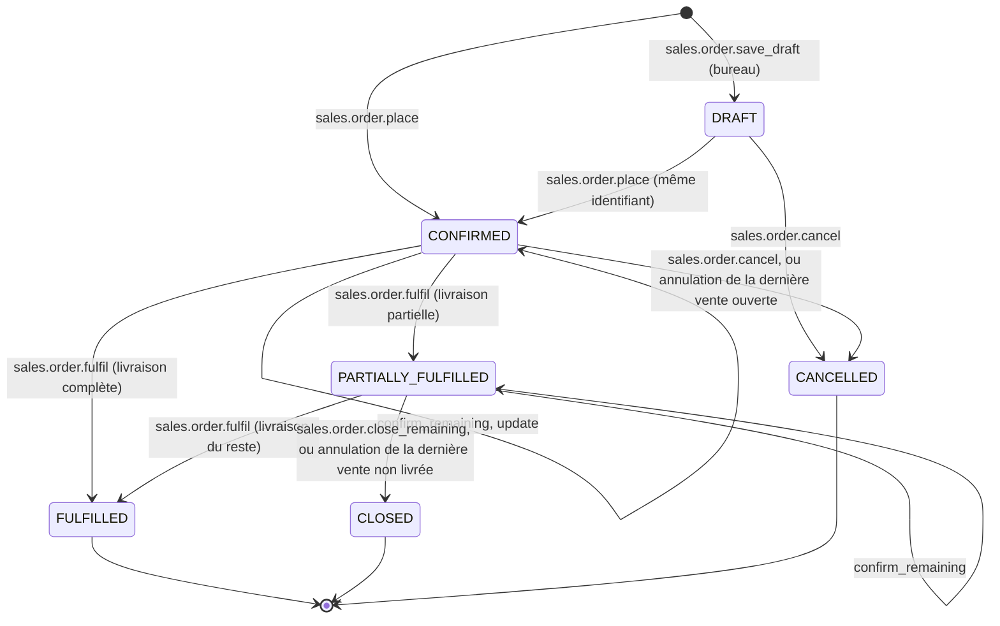
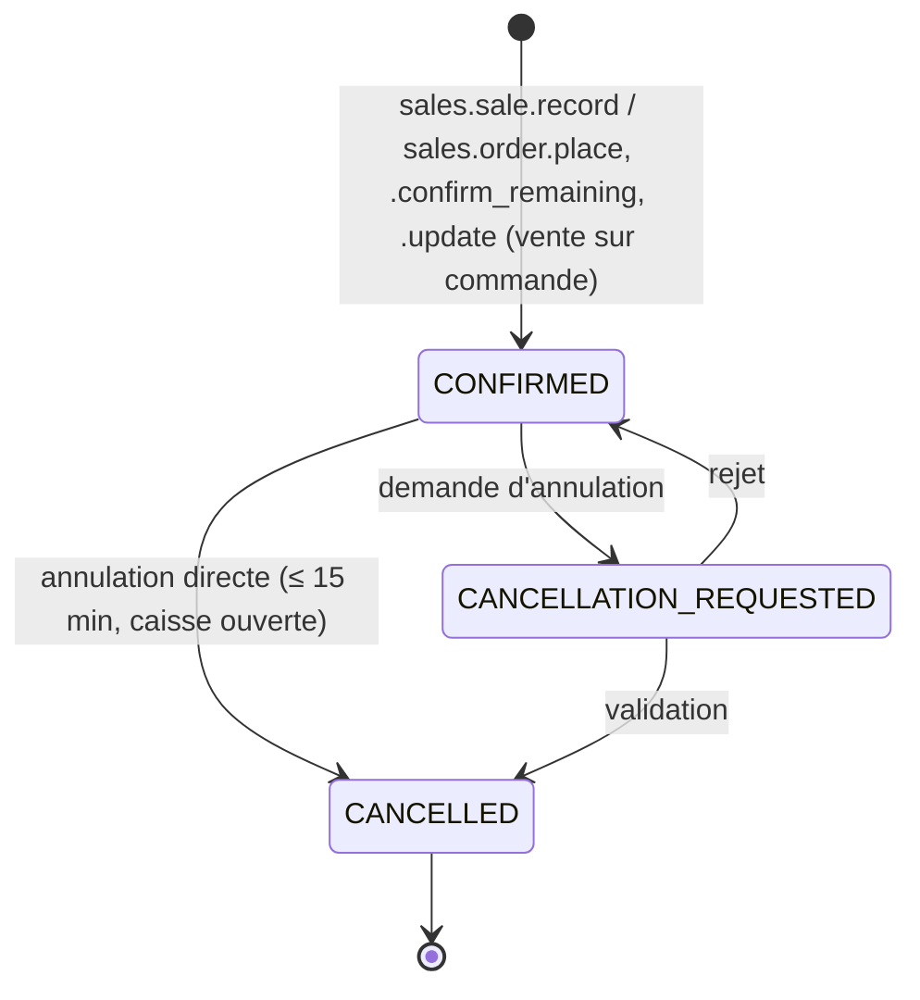
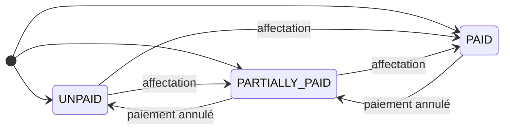
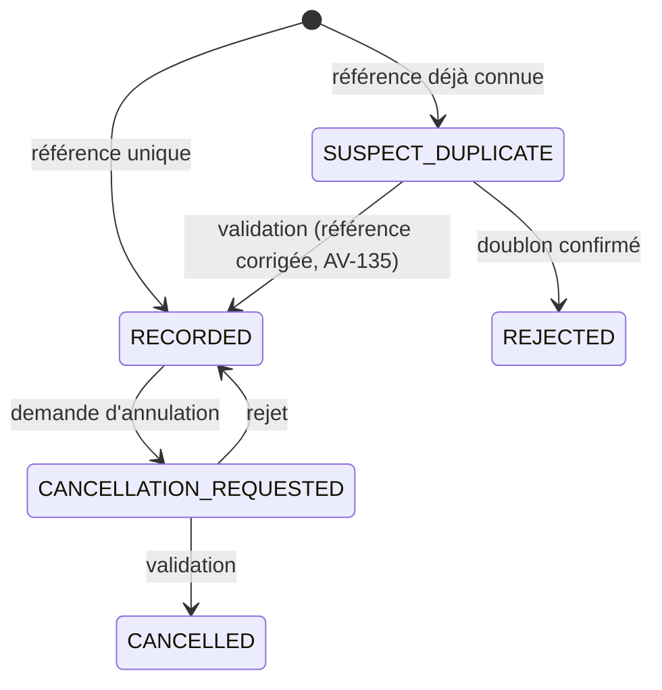
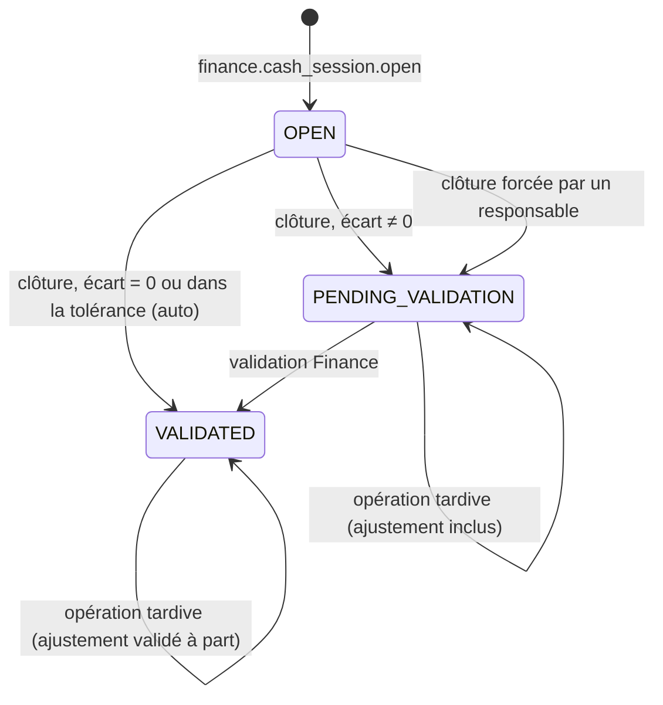
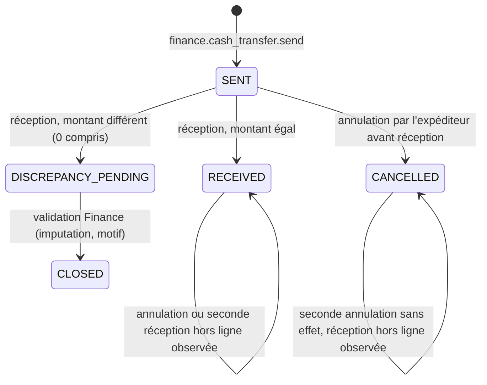

# Machines à états — Ventes, encaissements, caisse

## SM-ORDER — Commande client

Une seule dimension : le cycle de vie (`status`). Le statut est **dérivé des lignes** (`salesOrderStatusFromLines`, `packages/domain`), sauf `DRAFT` ; il n'y a ni réservation ni état de réservation (ADR-028 §4). Chaque ligne porte quatre quantités en unité de base — commandé en vigueur, vendu net des annulations, livré, retiré — d'où se dérivent « en attente » (commandé − vendu) et « à livrer » (vendu − livré), avec 0 ≤ livré ≤ vendu ≤ commandé (INV-VEN-04). Règles : [D04](../../01-functional/domaines/D04-VEN-commandes-ventes.md) §7.1 et §15.

| Statut | Dérivation |
|---|---|
| `DRAFT` | Brouillon de bureau (`save_draft`) : aucun effet de stock ni de chiffre d'affaires |
| `CONFIRMED` | Une quantité reste en attente ou à livrer, et rien n'a été livré |
| `PARTIALLY_FULFILLED` | Une quantité reste en attente ou à livrer, et une livraison a eu lieu |
| `FULFILLED` | Plus rien en attente ni à livrer ; une livraison a eu lieu |
| `CLOSED` | Plus rien en attente ni à livrer parce que le reste a été annulé (`close_remaining`, ou annulation de la dernière vente non livrée) ; une part a été livrée |
| `CANCELLED` | Plus rien en attente ni à livrer, et rien n'a été livré (annulation, ou annulation de la dernière vente ouverte) |

| État initial | Action | Condition | Nouvel état | Effets métier | Effets stock | Effets finance | Permission |
|---|---|---|---|---|---|---|---|
| `[*]` | `sales.order.save_draft` | En ligne ; client identifié ; ≥ 1 ligne ; prix résolus et figés à la saisie (BR-VEN-003, AV-148) | `DRAFT` | Numéro `CMD` ; `OrderDrafted` | — | — | `sales.order.create` |
| `[*]`, `DRAFT` | `sales.order.place` | Client identifié (BR-VEN-001) ; ≥ 1 ligne (celles du brouillon s'il existe) ; ni remise ni produit vendu au poids ; prix résolus (BR-VEN-003) ; crédit si reste dû (BR-VEN-025) | `CONFIRMED` | Numéro `CMD` (commande neuve) ; prix convenus figés ; brouillon confirmé : version +1 ; `OrderConfirmed` ; **vente du disponible** (BR-VEN-004), la commande n'est jamais refusée pour manque de stock | Pour le disponible : `SALE` de l'emplacement de préparation vers « à livrer », coût figé (SM-SALE) ; le reste demeure en attente, sans réservation | Acomptes joints encaissés et affectés à la commande, puis passés à la vente créée (`ORDER_CONFIRMED`) ; CA à `occurred_at` ; créance du reste dû, échéance depuis la confirmation | `sales.order.create` |
| `CONFIRMED`, `PARTIALLY_FULFILLED` | `sales.order.confirm_remaining` | Quantité en attente > 0 (sinon aucune vente) ; crédit si reste dû | inchangé (statut recalculé) | Nouvelle vente `ORDER` du disponible, au prix convenu ; `SaleConfirmed` ; la version ne bouge pas | `SALE` vers « à livrer » pour ce qui est devenu disponible | CA, créance ; l'acompte encore affecté à la commande passe à la nouvelle vente | `sales.order.create` |
| `CONFIRMED` | `sales.order.update` | Aucune livraison (sinon rejet `ORDER_NOT_MODIFIABLE`) ; `base_version` à jour (sinon quarantaine `VERSION_CONFLICT`) ; ≥ 1 changement ; commande jamais vidée (`ORDER_EMPTY`) | `CONFIRMED` | Version +1 ; audit avant / après ; `OrderUpdated` | Baisse : retrait de l'attente, puis `CUSTOMER_RETURN` de « à livrer » vers l'emplacement de préparation pour le vendu non livré ; hausse ou ligne ajoutée : `SALE` du disponible | Baisse : document `ANV` (cause `ORDER_ADJUSTMENT`) par vente touchée, CA négatif, argent payé libéré en crédit client ou remboursement ; hausse : vente complémentaire au prix convenu, CA, créance | `sales.order.create` (auteur ; portée `TEAM`) |
| `DRAFT`, `CONFIRMED` | `sales.order.cancel` | Aucune livraison (sinon `CANCELLATION_EXCEEDS_UNDELIVERED` : clôturer le reste) ; motif (`REASON_REQUIRED`) ; sans validation (AV-128) | `CANCELLED` | Version +1 ; `cancelled_at`, `cancelled_by`, motif ; `OrderCancelled` | Retour de tout le vendu : « à livrer » vers l'emplacement de préparation | Documents `ANV` (cause `ORDER_CANCELLATION`), CA négatif ; acompte et part payée libérés en crédit client ou remboursement (BR-VEN-009), sort consigné sur la commande | `sales.order.cancel` (auteur, Resp. commercial) |
| `PARTIALLY_FULFILLED` | `sales.order.close_remaining` | Motif (`REASON_REQUIRED`) ; hors de ce statut : `ORDER_STATUS_INVALID` ; sans validation (AV-128) | `CLOSED` | Version +1 ; `closed_at`, `closed_by`, `closed_reason` ; commandé de chaque ligne = livré ; `OrderClosed` | Retour du vendu non livré | Documents `ANV` (cause `ORDER_CLOSURE`), CA négatif ; acompte restant et part payée libérés (BR-VEN-009) | `sales.order.cancel` |
| `CONFIRMED`, `PARTIALLY_FULFILLED` | `sales.order.fulfil` (bon de livraison `LIV`, P4-07) | Quantité de chaque ligne ≤ vendu non livré (INV-VEN-04 ; en ligne, sinon `ORDER_OVER_FULFILMENT` sans écriture) ; aucune demande d'annulation en cours sur les ventes servies (`SALE_CANCELLATION_PENDING`) ; hors de ces statuts, en ligne : `ORDER_STATUS_INVALID` | `PARTIALLY_FULFILLED` tant qu'il reste de l'attente ou du « à livrer », sinon `FULFILLED` ; la version ne bouge pas | Bon `LIV` en ajout seul ; livré réparti sur les ventes, la plus ancienne d'abord (D04 §15) | `DELIVERY` : « à livrer » → `V_CUSTOMER`, à la valeur figée de la vente (un mouvement par `SALE` servi, ADR-029) | Aucun effet sur le CA (déjà reconnu à la confirmation, ADR-025) ; aucune vente | `sales.order.fulfil` (commerciaux `OWN`/`TEAM`, Magasinier `SITE`) |
| `CONFIRMED`, `PARTIALLY_FULFILLED` | Réaction à l'annulation d'une vente sur commande (`sales.sale.cancel`, `.request_cancellation` une fois appliquée, décision `SALE_CANCELLATION`) | Le non-livré seulement (ADR-029 §10) | Inchangé, ou `CANCELLED` (rien livré) / `CLOSED` (une part livrée) quand plus rien n'est ouvert | Quantités annulées retirées de la commande : commandé et vendu net baissent, cumul retiré monte ; version +1 (AV-149) | Effets de SM-SALE | Effets de SM-SALE | `system` (suite de `sales.sale.cancel`) |

**Livraison hors ligne** (P4-07) : fait accompli, jamais refusé pour l'état de la commande ; la part rattachable l'est, le surplus devient une vente directe de régularisation avec un conflit `ORDER_OVER_FULFILMENT` (AV-133), même sur une commande annulée ou clôturée, qui n'est pas rouverte.

**Hors ligne** : `place` est une intention que le serveur confirme à la synchronisation, avec l'heure métier de la saisie (AV-126) : la vente du disponible, l'affectation des acomptes et le chiffre d'affaires n'existent qu'à ce moment. `update`, `cancel` et `close_remaining` sont possibles hors ligne comme intentions sur l'état partagé : une `base_version` périmée met la modification en quarantaine (`VERSION_CONFLICT`, commande inchangée) ; une commande devenue livrée, terminée ou annulée côté serveur rejette la modification (`ORDER_NOT_MODIFIABLE`) ; une annulation devenue impossible est rejetée (`CANCELLATION_EXCEEDS_UNDELIVERED` après une livraison, `ORDER_ALREADY_CANCELLED`). La livraison hors ligne, y compris au-delà du vendu non livré (D04 §14, AV-133), relève de P4-07 et n'est pas décrite ici.

---

## SM-SALE — Vente

Cycle de vie (`status`) et statut de paiement **dérivé** (`payment_status`) sont orthogonaux (tension C-05). Correspondance avec la liste indicative du PM §24 :

| Terme PM §24 | Représentation |
|---|---|
| brouillon | Panier local `LOCAL_ONLY`, jamais synchronisé (BR-VEN-011) |
| confirmée | `status = CONFIRMED` |
| payée partiellement | `payment_status = PARTIALLY_PAID` |
| payée | `payment_status = PAID` |
| annulée | `status = CANCELLED` |

| État initial | Action | Condition | Nouvel état | Effets métier | Effets stock | Effets finance | Permission |
|---|---|---|---|---|---|---|---|
| `[*]` | `sales.sale.record` | Validations D04 §8 ; en ligne, disponible du vendeur (BR-VEN-018 : quota du couple puis stock libre ; sinon refus `ALLOCATION_EXCEEDED` ou `INSUFFICIENT_STOCK`, sans effet) ; hors ligne, fait accompli toujours appliqué (BR-SYN-007) ; plafond de dérogation | `CONFIRMED` | Prix figés ; attribution (BR-VEN-020) ; canal, zone ; numéro officiel ; conversion éventuelle du prospect ; `SaleConfirmed` ; hors ligne, anomalies de quota et de garde en drapeaux et avertissements (P5-11) | Un mouvement `SALE` (source → `V_CUSTOMER`) par ligne × lot, coût unitaire figé ; sur un emplacement `SHARED`, d'abord le quota du couple (auteur, appareil de l'inbox) : part portant `allocation_id` et entrée `CONSUME`, puis le stock libre (ADR-033 §5) ; hors ligne : `ALLOCATION_EXCEEDED` (quota dépassé, ou vente sans quota utilisable, AV-166), `ALLOCATION_REVOKED_CONSUMED`, `ALLOCATION_OVERCOMMITTED`, `CUSTODY_DEVICE_MISMATCH`, `STOCK_NEGATIVE` | CA à `occurred_at` ; encaissements et affectations ; mouvements de trésorerie ; créance du reste, avec échéance | `sales.sale.record` (+ `sales.credit_sale.record` si reste dû ; + `sales.price.override` si dérogation) ; la consommation du quota n'a pas de permission propre |
| `[*]` | `sales.order.place`, `sales.order.confirm_remaining`, `sales.order.update` (hausse ou ligne ajoutée) | SM-ORDER ; une quantité en attente et du stock disponible ; crédit si reste dû (BR-VEN-025) | `CONFIRMED` (type `ORDER`, une vente par confirmation) | Prix = prix convenu de la ligne de commande (`ORDER_QUOTE`, sans remise) ; commercial et canal de la commande ; échéance depuis la confirmation (AV-129) ; conversion éventuelle du prospect ; `SaleConfirmed` | Un mouvement `SALE` par ligne × lot, de l'emplacement de préparation vers « à livrer » (jamais de solde négatif), coût figé ; aucune réservation ; sur un emplacement `SHARED`, le **stock libre** seulement, y compris depuis l'élevage : aucun quota consommé ni entamé (ADR-033 §7) | CA à `occurred_at` ; l'acompte de la commande s'affecte à la vente (`ORDER_CONFIRMED`) ; créance du reste, avec échéance | `sales.order.create` |
| `CONFIRMED` | `sales.sale.cancel` (direct) | BR-VEN-028 : vendeur de la vente, ≤ `sales.direct_cancel_minutes` (15 min) ; chaque encaissement (`RECORDED` ou `CANCELLATION_REQUESTED`) de la vente sur une caisse de PDV dans une session qui couvre son heure et l'heure de l'annulation (P5-14, AV-185) ; sinon transformée en demande (`CANCEL_WINDOW_EXCEEDED`, `CANCEL_SESSION_CLOSED`) | `CANCELLED` | Document `ANV` ; motif ; `SaleCancelled` ; commande recalculée (vente sur commande : non-livré seulement, AV-149) | Retours `CUSTOMER_RETURN` rattachés aux `SALE` d'origine (ADR-029 : lot le plus récent d'abord, valeur d'origine), jamais des inverses ; la part imputée à un quota encore actif lui revient (`RESTORE`, plafonné, ADR-033 §8), sinon le stock commun | CA diminué à `applied_at` ; affectations renversées ; part payée remboursée (`REFUND`) ou gardée en crédit client, au choix de l'annulateur (AV-146) | `sales.sale.cancel` |
| `CONFIRMED` | `sales.sale.request_cancellation` | Hors du délai direct, ou session de caisse d'un encaissement ne couvrant pas l'heure de l'annulation (close ou absente) ; motif | `CANCELLATION_REQUESTED` | Demande `SALE_CANCELLATION` ; `SaleCancellationRequested` | — | — | `sales.sale.cancel` |
| `CANCELLATION_REQUESTED` | `approvals.request.approve` | Approbateur ≠ demandeur | `CANCELLED` | Comme l'annulation directe ; décision tracée | Comme l'annulation directe, à l'heure de la décision (retours rattachés ; `RESTORE` si le quota est encore actif à ce moment) | Comme l'annulation directe ; remboursement ou crédit au choix de l'approbateur (`decisionOption`) | `sales.sale_cancel.approve` |
| `CANCELLATION_REQUESTED` | `approvals.request.reject` | — | `CONFIRMED` | Décision tracée | — | — | `sales.sale_cancel.approve` |
| (tout état non annulé) | Affectation / désaffectation de paiement | BR-FIN-003 | `payment_status` recalculé | `amount_paid_xaf`, `balance_due_xaf` mis à jour | — | — | `system` |

**Hors ligne** : l'enregistrement, l'annulation directe (délai calculé sur l'horloge de l'appareil, puis revérifié par le serveur avec l'écart d'horloge) et la demande d'annulation sont possibles. Si le serveur juge le délai dépassé pour une annulation directe hors ligne, la commande devient automatiquement une demande d'annulation (`APPLIED_WITH_WARNINGS`). Les effets d'une annulation (retour de stock et d'argent) sont alors appliqués **seulement** après validation, mais la demande est tracée dès réception.

**Quotas d'appareil (P5-11, AT-003)** : sur un emplacement `SHARED`, la tablette bloque la vente au-delà de son quota, sans quota ou avec un quota échu, et le dit en français (`decideLocalConsumption`, AV-025) ; l'option « autorisée et signalée » du site la laisse passer. Le serveur applique toujours le fait reçu et en est le miroir (`offlineAllocationSignal`, même bibliothèque, ADR-021) : `ALLOCATION_EXCEEDED`, dont le motif reprend le code de la tablette (`ALLOCATION_EXCEEDED`, `ALLOCATION_MISSING`, `ALLOCATION_EXPIRED`) et dont `signalled` dit si le site autorisait le dépassement.

---

## SM-CUSTOMER-PAYMENT — Encaissement client

| État initial | Action | Condition | Nouvel état | Effets métier | Effets stock | Effets finance | Permission |
|---|---|---|---|---|---|---|---|
| `[*]` | `sales.payment.record` (ou inclus dans la vente) | BR-FIN-001 ; (moyen, référence) unique ; encaissement en espèces sur une caisse de PDV : session `OPEN` couvrant son heure (P5-14) — en ligne, refus `CASH_SESSION_REQUIRED` (précoce, puis contrôle repris sous le verrou du compte après l'écriture du mouvement) ; hors ligne, fait accompli : index nul, avertissement et conflit `CASH_SESSION_MISSING` (AV-184) | `RECORDED` | `PaymentReceived`, `PaymentAllocated` | — | Mouvement de trésorerie `IN` (index de session recopié sur l'encaissement) ; affectations (vente, commande, ou automatiques BR-FIN-004) ; créances recalculées | `sales.payment.record` |
| `[*]` | idem | Référence déjà connue (BR-FIN-005) | `SUSPECT_DUPLICATE` | `PaymentFlaggedDuplicate` ; demande de validation | — | **Aucun** mouvement ni affectation | `sales.payment.record` |
| `SUSPECT_DUPLICATE` | `approvals.request.approve` | Référence corrigée fournie (`decisionData.correctedReference`, AV-135 : seule exception à la référence figée), ou référence redevenue libre ; sinon refus `PAYMENT_REFERENCE_DUPLICATE` | `RECORDED` | Tracé | — | Mouvement de trésorerie et affectations appliqués ; index de session du mouvement recopié sur l'encaissement (`cash_session_id`) — aucune session exigée : sans session couvrante, index nul, ni refus ni constat (P5-14, AV-184, AV-186) | `sales.payment.cancel` (FINANCE) |
| `SUSPECT_DUPLICATE` | `approvals.request.reject` | — | `REJECTED` | Tracé | — | Aucun | `sales.payment.cancel` |
| `RECORDED` | `sales.payment.request_cancellation` | Motif | `CANCELLATION_REQUESTED` | Demande `PAYMENT_CANCELLATION` | — | — | `sales.payment.record` |
| `CANCELLATION_REQUESTED` | `approvals.request.approve` | — | `CANCELLED` | `PaymentCancelled` | — | Mouvement de trésorerie inverse, daté de l'encaissement d'origine, réévaluation `REVERSAL` de sa session close (AV-157 (a), P5-14) ; affectations désactivées ; créances rouvertes | `sales.payment.cancel` |
| `CANCELLATION_REQUESTED` | `approvals.request.reject` | — | `RECORDED` | Tracé ; motif et demande effacés de l'encaissement (conservés sur la demande) | — | — | `sales.payment.cancel` |
| `RECORDED` | `sales.payment.reallocate` (P4-08) | En ligne ; cibles du client, payables ; Σ ≤ crédit après libération | inchangé | Affectations libérées (`REALLOCATED`) et nouvelles | — | Créances recalculées ; crédit client réécrit | `sales.payment.reallocate` (FINANCE) |
| `RECORDED` | `sales.payment.refund` (P4-08) | En ligne ; montant ≤ crédit non affecté | inchangé | Part remboursée tracée (`refunded_xaf`) ; l'encaissement ne s'annule plus (AV-151) | — | Mouvement `REFUND` (sortie, jamais en négatif pour une caisse) | `sales.payment.refund` (FINANCE) |

**Hors ligne** : l'enregistrement est possible. Le contrôle d'unicité local porte seulement sur les références connues de l'appareil ; le contrôle serveur fait foi.

---

## SM-CASH-SESSION — Session de caisse

> Corrigée par ADR-032 (08/10/2026) : l'écart n'est compté qu'une fois. L'attendu se tire du registre par **fenêtre de temps** (`[ouverture, clôture[` du compte) ; l'écart d'ouverture appartient à la période précédente et n'entre pas dans l'attendu ; une réévaluation pose le **delta** ; la session `VALIDATED` est figée, l'ajustement tardif est une ligne de `finance_cash_session_adjustments`.

| État initial | Action | Condition | Nouvel état | Effets métier | Effets stock | Effets finance | Permission |
|---|---|---|---|---|---|---|---|
| `[*]` | `finance.cash_session.open` | Caisse de PDV, en ligne comme hors ligne (`CASH_SESSION_POS_ACCOUNT_REQUIRED`, AV-165) ; en ligne : site ouvert, caisse active, aucune session ouverte (`CASH_SESSION_ALREADY_OPEN`), aucune session dont la fenêtre couvre l'heure d'ouverture (`CASH_SESSION_OVERLAP`), limite du jour métier (`CASH_SESSION_DAILY_LIMIT`, `finance.cash_sessions_per_day_max`) ; hors ligne : ouverture concurrente **fusionnée** dans la plus ancienne session en cause, sans écriture, comptage conservé (conflit `CASH_SESSION_CONCURRENT_OPEN`, AV-154, AV-167), ou **décalée** à la clôture d'une session de la veille close depuis (AV-168) ; fonds compté ≥ 0 | `OPEN` (aucune transition pour une fusion) | `CashSessionOpened` (création seulement) ; `CashVarianceDetected` (phase `OPENING`) si écart ; à la création seulement (jamais une fusion), résolution (`MERGE`, référence de la session) des conflits ouverts `CASH_SESSION_MISSING` des encaissements de la caisse dont le mouvement est sans index et daté à l'heure d'ouverture ou après, sans borne haute (P5-14, AV-184 ; une clôture ultérieure datée avant l'encaissement ne rouvre pas le conflit : AV-171) | — | Écart d'ouverture = fonds compté − solde du registre à l'ouverture : mouvement `SESSION_VARIANCE` posé à l'ouverture, **hors** de l'attendu de la session, validé avec elle (BR-FIN-014, AV-156) | `finance.cash_session.operate` |
| `OPEN` | `finance.cash_session.close` | Comptage saisi (le payload ne porte jamais l'écart) ; heure de clôture ≥ ouverture ; en ligne, aucun mouvement du compte daté à l'heure de clôture ou après (`CASH_SESSION_CLOSE_BEFORE_LAST_MOVEMENT`, AV-171) ; tout vendeur du site, `closed_by` = l'auteur (AV-155) ; un identifiant fusionné vise la session retenue (alias) | `VALIDATED` d'office (`auto_validated`, `validated_at` = clôture) si l'écart d'ouverture et l'écart de clôture sont nuls ou tolérés (`finance.cash_variance_tolerance_xaf`) et, hors ligne, si la clôture ne précède aucun mouvement déjà enregistré ; sinon `PENDING_VALIDATION` (conflit informatif `CASH_SESSION_CLOSE_BEFORE_MOVEMENTS` dans ce dernier cas, AV-171) | Attendu par fenêtre (ADR-032 §3) ; `CashSessionClosed` ; `CashVarianceDetected` (phase `CLOSING`) si écart ; en ligne, session close : `CASH_SESSION_NOT_OPEN`, clôture avant l'ouverture : `CASH_SESSION_CLOSE_BEFORE_OPEN` ; hors ligne, sur une session déjà close (ou close d'office) ou avant son ouverture : comptage conservé, aucune transition, conflit informatif `CASH_SESSION_CONCURRENT_CLOSE` (AV-169) | — | Mouvement `SESSION_VARIANCE` de l'écart de clôture, à la clôture | `finance.cash_session.operate` |
| `OPEN` | `finance.cash_session.force_close` | En ligne seulement (`ONLINE_REQUIRED`) ; session ouverte depuis **plus de** `finance.cash_session_force_close_hours` (24 h par défaut, borne stricte, `CASH_SESSION_FORCE_CLOSE_TOO_EARLY`) ; aucun mouvement du compte daté à l'heure de clôture ou après (`CASH_SESSION_CLOSE_BEFORE_LAST_MOVEMENT`, AV-171) ; comptage déclaré et motif | `PENDING_VALIDATION` (même sans écart) | Tracé (motif dans l'audit et `CashSessionClosed`) ; `force_closed`, `forced_by` = `closed_by` ; l'auteur ne peut pas valider ; écart imputé à l'ouvreur (AV-170) | — | Idem | `finance.cash_session.validate` |
| `PENDING_VALIDATION` | `finance.cash_session.validate` (en ligne ; façade de la décision `CASH_VARIANCE`, ou `approvals.request.approve` de la demande) | Motif si écart (`REASON_REQUIRED`) ; valideur ≠ ouvreur, clôtureur, auteur de la clôture forcée (`CASH_VALIDATOR_INVOLVED`, AV-155) et ≠ demandeur (BR-ADM-017) ; rejet et retrait de la demande refusés (AV-159) ; sans demande (aucune politique à la clôture), validation directe (AV-183) | `VALIDATED` | `CashSessionValidated` ; les ajustements inclus sont validés avec elle ; demande `APPROVED` | — | — | `finance.cash_session.validate` |
| `PENDING_VALIDATION`, `VALIDATED` | Réaction : opération tardive de `occurred_at` dans la fenêtre (`recordCashMovement`, P5-13) | Delta non nul | inchangé | Attendu recalculé ; ligne d'ajustement (`LATE_OPERATION` ou `REVERSAL`) ; alerte `CashVarianceDetected` phase `ADJUSTMENT` ; conflit `CASH_SESSION_REEVALUATED` ; sur `VALIDATED`, demande `CASH_VARIANCE` propre (sujet : l'ajustement), validée par la même façade | — | Mouvement `SESSION_VARIANCE` du **delta** (nouvel écart − Σ des écarts déjà posés), daté de la clôture, BR-DIS-008 | `system` |

**Hors ligne** : ouverture et clôture sont possibles (faits accomplis, jamais rejetés pour un état métier : BR-SYN-007) ; la validation est en ligne. Le refus ou le recomptage d'un écart n'existe pas : une erreur de comptage se corrige par un ajustement validé (AV-159).

---

## SM-CASH-TRANSFER — Remise de fonds

| État initial | Action | Condition | Nouvel état | Effets métier | Effets stock | Effets finance | Permission |
|---|---|---|---|---|---|---|---|
| `[*]` | `finance.cash_transfer.send` | Paire de comptes admise (`finance.cash_transfer_allowed_pairs`, AV-158 ; refus en ligne seulement) ; compte source dans la portée de l'auteur ; en ligne, solde suffisant d'une caisse physique et compte destinataire actif | `SENT` | `CashTransferSent` (= `finance.cash_transfer.send`) ; numéro `RMF` (AV-176) ; hors ligne : `CASH_NEGATIVE` ou `CASH_TRANSFER_PAIR_NOT_ALLOWED` avec conflit pour la Finance | — | `TRANSFER_OUT` du montant envoyé sur le compte source | `finance.cash_transfer.record` |
| `SENT` | `finance.cash_transfer.receive` | Montant reçu = envoyé ; récepteur ≠ expéditeur (`CASH_TRANSFER_SELF_RECEIVE`, en ligne et hors ligne, AV-172) ; compte destinataire dans sa portée | `RECEIVED` | `CashTransferReceived` (= `finance.cash_transfer.receive`) | — | `TRANSFER_IN` sur le compte destination | `finance.cash_transfer.record` |
| `SENT` | `finance.cash_transfer.receive` | Montant reçu ≠ envoyé (manque, excédent, ou 0 pour une remise perdue, AV-175) | `DISCREPANCY_PENDING` | `CashTransferDiscrepancyDetected` ; écart signé = reçu − envoyé ; demande `CASH_TRANSFER_DISCREPANCY` (montant = \|écart\|) | — | `TRANSFER_IN` du montant reçu ; **aucun** pour une réception de 0 | `finance.cash_transfer.record` |
| `DISCREPANCY_PENDING` | `approvals.request.approve` (type `CASH_TRANSFER_DISCREPANCY`) | Imputation (`decisionOption`) : expéditeur, porteur (s'il est connu), récepteur ou entreprise (AV-153) ; motif (`decisionData.reason`) ; valideur ni expéditeur, ni récepteur, ni porteur (AV-174) | `CLOSED` | Écart, imputation, motif, valideur et date enregistrés **sur la remise** (`CashTransferDiscrepancyClosed` = `approvals.request.approve`) | — | **Aucun second mouvement** : la différence est déjà sortie des livres (`TRANSFER_OUT` du montant envoyé, `TRANSFER_IN` du montant reçu ; ADR-032 §7) | `finance.cash_session.validate` |
| `DISCREPANCY_PENDING` | `approvals.request.reject`, `.withdraw` | — | Inchangé | Refusés (`CASH_TRANSFER_DISCREPANCY_NOT_REJECTABLE`, `_NOT_WITHDRAWABLE`) : l'écart se décide toujours (AV-174) | — | — | — |
| `SENT` | `finance.cash_transfer.cancel` | Par l'expéditeur seul (`CASH_TRANSFER_NOT_SENDER`, en ligne et hors ligne) ; motif | `CANCELLED` | `CashTransferCancelled` (= `finance.cash_transfer.cancel`) ; motif, auteur, date | — | Mouvement inverse sur le compte source, **daté de l'annulation** (fait physique nouveau, ADR-032 §2, AV-157) | `finance.cash_transfer.record` (expéditeur) |
| `CANCELLED` | `finance.cash_transfer.cancel` | — | `CANCELLED` | Sans effet (rejeu) | — | — | `finance.cash_transfer.record` |
| `CANCELLED` | `finance.cash_transfer.receive` | En ligne : refus `CASH_TRANSFER_CANCELLED` ; hors ligne : course | Inchangé | Observation : conflit informatif `CASH_TRANSFER_RECEIVED_AFTER_CANCEL` (Finance), avertissement (AV-173) | — | Aucun | `finance.cash_transfer.record` |
| `RECEIVED`, `DISCREPANCY_PENDING`, `CLOSED` | `finance.cash_transfer.receive`, `.cancel` | En ligne : refus `CASH_TRANSFER_ALREADY_RECEIVED` ; hors ligne : course | Inchangé | Observation : conflit informatif `CASH_TRANSFER_RECEIVED_TWICE` ou `CASH_TRANSFER_CANCEL_AFTER_RECEIVE` (Finance), avertissement (AV-173) | — | Aucun | `finance.cash_transfer.record` |

**Hors ligne** : envoi et annulation sont possibles hors ligne ; la réception se fait en général en ligne (Finance), mais reste possible hors ligne. Les courses entre appareils (réception après annulation, annulation après réception, double réception) ne sont jamais rejetées : le fait est conservé comme observation, sans mouvement, et la Finance régularise (AV-173). La table des transitions est la fonction de domaine `decideCashTransferAction` (P5-15), partagée par l'appareil et le serveur.
