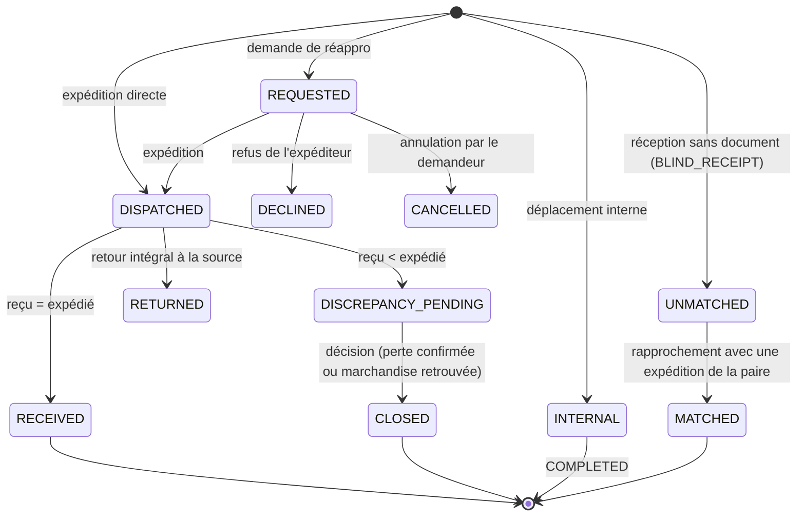
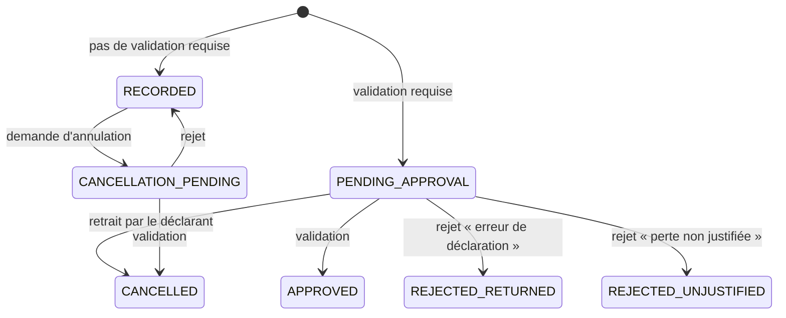
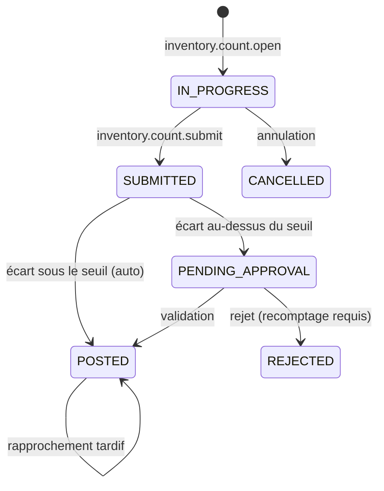
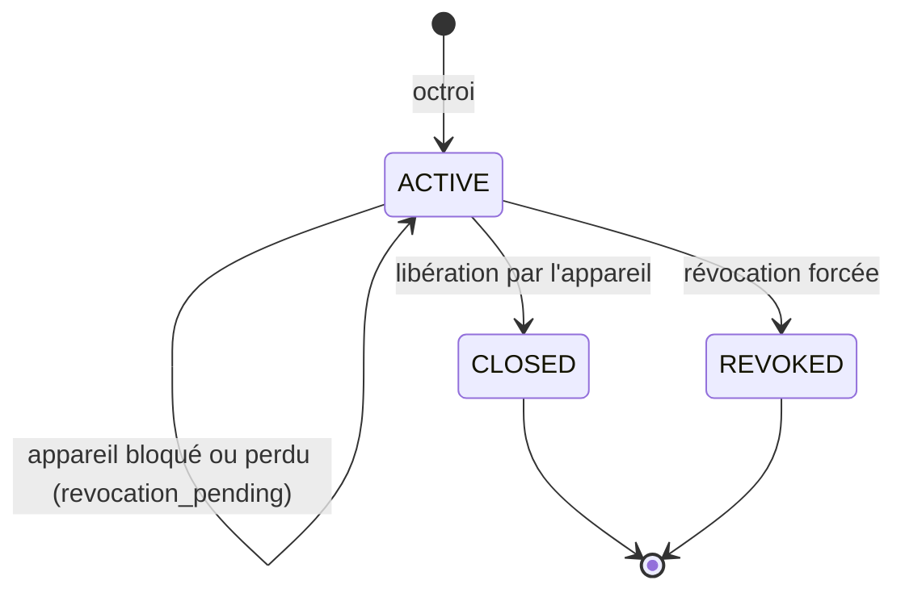

# Machines à états — Stock

## SM-TRANSFER — Transfert de stock

Trois natures (`transfer_kind`) : `STANDARD` (deux temps, avec transit), `INTERNAL` (immédiat, même site), `BLIND_RECEIPT` (réception sans document, BR-STK-024).

| État initial | Action | Condition | Nouvel état | Effets métier | Effets stock | Effets finance | Permission |
|---|---|---|---|---|---|---|---|
| `[*]` | `inventory.transfer.request` | Destination = emplacement du demandeur ; quantités > 0 | `REQUESTED` | `StockTransferRequested` ; notification à l'expéditeur | — | — | `inventory.transfer.request` |
| `REQUESTED` | `inventory.transfer.decline` | Motif | `DECLINED` | Notification au demandeur | — | — | `inventory.transfer.dispatch` |
| `REQUESTED` | `inventory.transfer.cancel` | Demandeur | `CANCELLED` | — | — | — | `inventory.transfer.request` |
| `[*]`, `REQUESTED` | `inventory.transfer.dispatch` | Disponible suffisant (en ligne) ou allocation / exclusif (hors ligne) ; source ≠ destination | `DISPATCHED` | Expéditeur, heure, transporteur éventuel ; `StockTransferDispatched` ; notification au destinataire | `TRANSFER_DISPATCH` source → `V_TRANSIT` (coût figé) ; réservation transférée si le transfert référence une commande (BR-VEN-010) | — (la valeur voyage avec le stock) | `inventory.transfer.dispatch` |
| `DISPATCHED` | `inventory.transfer.receive` | Quantités reçues = expédiées | `RECEIVED` | Réceptionnaire, heure ; `StockTransferReceived` | `TRANSFER_RECEIPT` `V_TRANSIT` → destination, un par mouvement d'expédition (lot et valeur de l'expédition, P5-16) | — | `inventory.transfer.receive` |
| `DISPATCHED` | `inventory.transfer.receive` | Au moins une ligne reçue < expédiée ; motif | `DISCREPANCY_PENDING` | `StockTransferDiscrepancyDetected` ; demande `TRANSFER_DISCREPANCY` | `TRANSFER_RECEIPT` (reçu) + `TRANSFER_DISCREPANCY` `V_TRANSIT` → `V_PENDING_LOSS` (écart) | Valeur de l'écart visible | `inventory.transfer.receive` |
| `DISCREPANCY_PENDING` | `approvals.request.approve` (perte confirmée) | Approbateur ≠ réceptionnaire | `CLOSED` | Imputation au transfert ; `StockTransferDiscrepancyResolved` | `LOSS_CONFIRMATION` `V_PENDING_LOSS` → `V_LOSS` (catégorie `ECART_TRANSFERT`) | Valeur perdue | `inventory.transfer_discrepancy.approve` |
| `DISCREPANCY_PENDING` | `approvals.request.reject` (marchandise retrouvée) | Recomptage | `CLOSED` | Tracé | `LOSS_RELEASE` `V_PENDING_LOSS` → destination | — | `inventory.transfer_discrepancy.approve` |
| `DISPATCHED` | `inventory.transfer.return_to_source` | Aucune réception (documentée, ni sans document en attente de cette expédition) ; motif obligatoire | `RETURNED` | Tracé ; lignes `returned` = `dispatched` ; `returned_by`, `returned_at`, `return_reason` | `TRANSFER_RECEIPT` inverse de chaque `TRANSFER_DISPATCH` (`V_TRANSIT` → source), même lot, même quantité, même valeur (INV-STK-04) ; quota d'appareil consommé à l'expédition rendu s'il est actif (`RESTORE`, ADR-033 §8) | — | `inventory.transfer.dispatch` |
| `[*]` | `inventory.transfer.move_internal` | Même site ; disponible suffisant | `COMPLETED` | `StockTransferReceived` (interne) | `INTERNAL_MOVE` source → destination | — | `inventory.transfer.dispatch` |
| `[*]` | `inventory.transfer.receive` (sans document), expédition de la paire déjà connue | Destination exclusive ; source déclarée ; expédition `DISPATCHED` de la même paire éligible (AV-177) | `MATCHED` (`BLIND_RECEIPT`) | La réception est appliquée comme une réception du transfert expédié, qui passe `RECEIVED` ou `DISCREPANCY_PENDING` (demande `TRANSFER_DISCREPANCY` au nom du réceptionnaire) ; `matched_transfer_id`, `matched_at` ; excédent : avertissement et conflit `TRANSFER_OVER_RECEIVED` | Comme la réception avec document : `TRANSFER_RECEIPT` (lot et valeur de l'expédition), `TRANSFER_DISCREPANCY` éventuel | Valeur de l'écart visible | `inventory.transfer.receive` |
| `[*]` | `inventory.transfer.receive` (sans document), aucune expédition connue | Destination exclusive (en ligne : sinon `BLIND_RECEIPT_NOT_ALLOWED` ; hors ligne : fait appliqué, `CUSTODY_DEVICE_MISMATCH`, AV-178) ; source déclarée ; lot indiqué pour un produit suivi par lot (en ligne) | `UNMATCHED` (`BLIND_RECEIPT`) | Document `BLIND_RECEIPT` (numéro `TRF` du site source) ; avertissement `TRANSFER_UNMATCHED` « en attente de rapprochement » | `TRANSFER_RECEIPT` `V_TRANSIT` → destination, transit non rapproché de la paire (source, destination), qui peut devenir négatif | — | `inventory.transfer.receive` |
| `UNMATCHED` | Rapprochement automatique à l'application de l'expédition (`inventory.transfer.dispatch`) | Expédition `DISPATCHED` de la même paire éligible (AV-177) | `MATCHED` | Le transfert expédié passe `RECEIVED` ou `DISCREPANCY_PENDING` selon les quantités reçues ; conflit `TRANSFER_UNMATCHED` éventuel clos (`MERGE`) | Requalification (AV-179) : contre-passation exacte de la réception sans document (`TRANSFER_DISPATCH` inverse), puis `TRANSFER_RECEIPT` (et `TRANSFER_DISCREPANCY` éventuel) au lot et à la valeur de l'expédition, datés de la réception et à son auteur | Valeur de l'écart visible | `system` |
| `UNMATCHED` | Rapprochement par la tâche horaire `inventory.transfers.unmatched_sweep` | Idem (filet : concurrence, politique `TRANSFER_DISCREPANCY` ajoutée après coup) | `MATCHED` | Idem ; événement `StockTransferReceived` ou `StockTransferDiscrepancyDetected`, audit sous l'utilisateur système (`inventory.transfer.auto_match`) | Idem | Idem | `system` |
| `UNMATCHED` | Délai de 48 h dépassé (`inventory.transfer_unmatched_hours`, depuis l'heure de la réception) | Aucun rapprochement | `UNMATCHED` | Conflit informatif `TRANSFER_UNMATCHED` au responsable du stock expéditeur, une seule fois ; événement `StockTransferUnmatched` (alerte : P9) | — | — | `system` |

**Hors ligne** : demande, expédition, réception (avec ou sans document), retour et déplacement interne sont possibles. Refus et décisions sur écart sont en ligne. Un fait hors ligne n'est jamais rejeté pour une raison d'état (BR-SYN-007) : le premier fait appliqué l'emporte et le second, physiquement contradictoire, est mis en **quarantaine** (résultat `CONFLICT`, aucun mouvement, AV-180) — réception d'un transfert `RETURNED` ou retour d'un transfert reçu (`TRANSFER_RETURN_CONFLICT`), retour d'un transfert dont une réception sans document attend l'expédition (`TRANSFER_RETURN_CONFLICT`), seconde réception, ou réception avec document d'un transfert qu'une réception sans document attend (`TRANSFER_OVER_RECEIVED`, raison `BLIND_RECEIPT_PENDING`) ; un second retour est appliqué sans effet. En ligne, ces cas sont refusés (`TRANSFER_STATUS_INVALID`). Une réception supérieure à l'expédié (réception sans document rapprochée sur-le-champ comprise) est refusée en ligne et appliquée hors ligne avec l'avertissement et le conflit informatif `TRANSFER_OVER_RECEIVED` (BR-STK-021).

---

## SM-LOSS — Déclaration de perte

| État initial | Action | Condition | Nouvel état | Effets métier | Effets stock | Effets finance | Permission |
|---|---|---|---|---|---|---|---|
| `[*]` | `inventory.loss.declare` (ou `production.mortality.record`) | Politique : pas de validation (BR-STK-031) ; pièces et commentaire requis présents | `RECORDED` | `StockLossDeclared` (+ `MortalityRecorded`) ; alertes éventuelles | `LOSS` emplacement → `V_LOSS` ; allocation consommée si le déclarant en détient une | Valeur perdue = quantité × coût figé | `inventory.loss.declare` / `production.daily.record` |
| `[*]` | idem | Politique : validation requise | `PENDING_APPROVAL` | Demande `LOSS_DECLARATION` ou `MORTALITY` | `LOSS_PENDING` emplacement → `V_PENDING_LOSS` | Valeur en attente | idem |
| `PENDING_APPROVAL` | `approvals.request.approve` | Approbateur ≠ déclarant ; pièce reçue si requise | `APPROVED` | `StockLossApproved` | `LOSS_CONFIRMATION` `V_PENDING_LOSS` → `V_LOSS` | Valeur perdue reconnue | `inventory.loss.approve` / `production.mortality.approve` |
| `PENDING_APPROVAL` | `approvals.request.reject` (`ERREUR_DECLARATION`) | — | `REJECTED_RETURNED` | `StockLossRejected` | `LOSS_RELEASE` `V_PENDING_LOSS` → emplacement | — | idem |
| `PENDING_APPROVAL` | `approvals.request.reject` (`PERTE_NON_JUSTIFIEE`) | — | `REJECTED_UNJUSTIFIED` | Catégorie reclassée `INEXPLIQUEE` ; imputation au déclarant ou au lieu ; `StockLossRejected` | `LOSS_CONFIRMATION` `V_PENDING_LOSS` → `V_LOSS` | Valeur perdue (inexpliquée) | idem |
| `PENDING_APPROVAL` | `inventory.loss.withdraw` | Déclarant, avant décision | `CANCELLED` | Demande annulée | `LOSS_RELEASE` `V_PENDING_LOSS` → emplacement | — | `inventory.loss.declare` |
| `RECORDED` | `inventory.loss.request_cancellation` | Motif | `CANCELLATION_PENDING` | Demande `LOSS_CANCELLATION` | — | — | `inventory.loss.declare` |
| `CANCELLATION_PENDING` | `approvals.request.approve` | — | `CANCELLED` | Tracé | Inverse du `LOSS` : `V_LOSS` → emplacement | Valeur perdue annulée | `inventory.loss.approve` |
| `CANCELLATION_PENDING` | `approvals.request.reject` | — | `RECORDED` | Tracé | — | — | `inventory.loss.approve` |

**Hors ligne** : la déclaration et le retrait sont possibles hors ligne ; les décisions sont en ligne. La politique évaluée par l'appareil est indicative ; le serveur réévalue (BR-PRD-006). Si le serveur exige une validation non prévue localement, le mouvement appliqué est `LOSS_PENDING` au lieu de `LOSS`.

---

## SM-INVENTORY-COUNT — Inventaire

| État initial | Action | Condition | Nouvel état | Effets métier | Effets stock | Effets finance | Permission |
|---|---|---|---|---|---|---|---|
| `[*]` | `inventory.count.open` | Aucun inventaire ouvert sur l'emplacement | `IN_PROGRESS` | `InventoryCountOpened` | — (l'activité continue, BR-STK-041) | — | `inventory.count.perform` |
| `IN_PROGRESS` | `inventory.count.record_lines` | Quantités ≥ 0 | `IN_PROGRESS` | Lignes comptées, `counted_at` par ligne | — | — | `inventory.count.perform` |
| `IN_PROGRESS` | `inventory.count.submit` | ≥ 1 ligne | `SUBMITTED` puis immédiatement `POSTED` ou `PENDING_APPROVAL` | Théorique à `counted_at` (BR-STK-042) ; écarts ; `InventoryCountSubmitted` | — (tant que non comptabilisé) | Valeur des écarts calculée | `inventory.count.perform` |
| `SUBMITTED` | Évaluation de politique | \|valeur des écarts\| < seuil | `POSTED` | `InventoryAdjusted` | `INVENTORY_GAIN` / `INVENTORY_LOSS` datés de `counted_at` | Valeur des écarts | `system` |
| `SUBMITTED` | Évaluation de politique | ≥ seuil | `PENDING_APPROVAL` | Demande `INVENTORY_ADJUSTMENT` ; alerte `INVENTORY_VARIANCE` | — | — | `system` |
| `PENDING_APPROVAL` | `approvals.request.approve` | Motifs d'écart renseignés ; approbateur ≠ compteur | `POSTED` | `InventoryAdjusted` | Ajustements datés de `counted_at` | Valeur des écarts | `inventory.count.approve` |
| `PENDING_APPROVAL` | `approvals.request.reject` | — | `REJECTED` | Recomptage demandé (nouvel inventaire) | — | — | `inventory.count.approve` |
| `IN_PROGRESS` | `inventory.count.cancel` | — | `CANCELLED` | — | — | — | `inventory.count.perform` |
| `POSTED` | Réaction : mouvement tardif de `occurred_at` ≤ `counted_at` (BR-STK-044) | — | `POSTED` | Écart net mis à jour ; `InventoryCountReconciled` | Ajustement compensatoire rattaché | Valeur d'écart ajustée | `system` |

Inventaire d'ouverture (`count_type = OPENING`) : même machine ; théorique nul ; mouvements `OPENING_BALANCE` depuis `V_OPENING` ; toujours soumis à validation (`inventory.opening.post`).

**Hors ligne** : ouverture, comptage et soumission (mise en file) sont possibles. Le calcul du théorique et la comptabilisation sont serveur.

---

## SM-ALLOCATION — Allocation (quota d'appareil)

> Réduite au quota d'appareil par ADR-028 §4 et ADR-033 : la réservation de commande n'existe plus (la confirmation vend le disponible vers l'emplacement « à livrer »).

| État initial | Action | Condition | Nouvel état | Effets métier | Effets stock | Effets finance | Permission |
|---|---|---|---|---|---|---|---|
| `[*]` | `inventory.allocation.grant` (`DEVICE_QUOTA`) | Emplacement `SHARED` ; appareil actif de l'utilisateur ; Σ restes des quotas actifs ≤ Σ soldes du produit (INV-STK-19) | `ACTIVE` | `StockAllocated` ; téléchargée par l'appareil détenteur | Aucun mouvement ; disponible des autres réduit | — | `inventory.allocation.manage` |
| `ACTIVE` | Consommation, par un fait de l'appareil seulement : vente directe (`sales.sale.record`, P5-11), perte, transfert sortant, consommation (P5-09) ; jamais par une confirmation de commande, une livraison, une régularisation ni une annulation (ADR-033 §7) | Couple (utilisateur, appareil) du quota, lu dans l'inbox (INV-STK-11) ; en ligne : le quota d'abord, puis le stock libre ; refus `ALLOCATION_EXCEEDED` sans effet de ce que ni l'un ni l'autre ne couvre (un dépassement couvert par le stock libre est une sortie normale, sans conflit) ; hors ligne : quota ramené à 0, l'excédent pris sur le stock commun et conflit `ALLOCATION_EXCEEDED` (AV-161) | `ACTIVE` | Entrée `CONSUME` ; reste jamais négatif (INV-STK-10) ; quota relu sous verrou, après les soldes (deux ventes concurrentes du même couple se sérialisent : la seconde est refusée, jamais rejouée) | Le mouvement métier (`SALE`…) porte `allocation_id` pour la part imputée | — | (permission de l'opération) |
| `ACTIVE` | Restitution (P5-10) : annulation d'une vente (`returnSoldGoods`), inverse d'un mouvement (`reverseDocumentMoves`), libération d'une perte en attente (`LOSS_RELEASE`, retrait ou rejet) | Quota encore actif ; quantité plafonnée à ce que le fait d'origine y a consommé, déduction faite de ce qui a déjà été rendu ; sinon (quota libéré, révoqué, ou rien consommé) elle retourne au stock commun | `ACTIVE` | Entrée `RESTORE` ; le mouvement de retour porte l'`allocation_id` | Le mouvement de retour (`CUSTOMER_RETURN`, inverse, `LOSS_RELEASE`) rattaché ; scindé si une part seulement revient au quota | — | (permission de l'opération) |
| `ACTIVE` | `inventory.allocation.increase` (en ligne, `base_version` exigée : deux augmentations sur la même version, la seconde est mise en conflit `VERSION_CONFLICT`) | Σ restes ≤ Σ soldes ; détenteur et appareil `ACTIVE`, aucune révocation en attente (sinon `ALLOCATION_HOLDER_INVALID`, comme à l'octroi ; **DÉDUIT**, P5-21 : un quota signalé n'appelle que la décision d'un responsable) | `ACTIVE` | Entrée `INCREASE` ; `StockAllocationIncreased` | — | — | `inventory.allocation.manage` |
| `ACTIVE` | `inventory.allocation.release` | Commande émise par l'appareil détenteur (déclare le reste ; seul le détenteur, depuis son appareil : sinon `ALLOCATION_NOT_HOLDER`) | `CLOSED` (cause `RELEASED`, ou `EXPIRED_RELEASED` après l'échéance) | Entrée `RELEASE` du **reste du serveur** ; `StockAllocationReleased` ; un écart avec le reste déclaré ferme le quota sur le reste du serveur et ouvre l'avertissement et le conflit appliqué `ALLOCATION_RELEASE_MISMATCH` (jamais corrigé en silence) | Disponible des autres augmenté | — | `inventory.allocation.release` (portée propre, AV-162) |
| `ACTIVE` | Appareil bloqué ou déclaré perdu, utilisateur désactivé | — | `ACTIVE`, `revocation_pending` | `AllocationRevocationPending` (alerte au responsable : P9) ; aucun mouvement automatique ; le signal se lève au déblocage ou à la réactivation si l'autre moitié du couple est en service | — | — | `system` (consommateur `inventory.allocation_revocation`) |
| `ACTIVE` | `inventory.allocation.revoke` | Motif ; responsable | `REVOKED` | `StockAllocationRevoked` ; consommation hors ligne ultérieure imputée (selon `occurred_at`) : `ALLOCATION_REVOKED_CONSUMED` ; fait hors ligne antérieur au-delà du reste à la révocation : `ALLOCATION_EXCEEDED` | Disponible des autres augmenté | — | `inventory.allocation.manage` |

**Hors ligne** : seules la consommation (locale) et la libération (commande en file) sont possibles hors ligne. Octroi, augmentation et révocation sont en ligne. Un quota atteint sa date `valid_until` : l'appareil cesse de l'utiliser localement et émet la libération à la synchronisation suivante ; le serveur ne libère jamais seul : la tâche `inventory.allocations.expiry_daily` publie `AllocationExpired` (au plus un par quota et par jour métier), alerte au responsable (P9).
