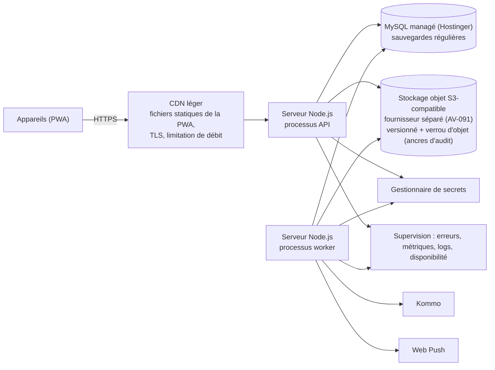

# Architecture de déploiement

> Section 31 du format final (PM §48). Contraintes : coût d'exploitation raisonnable, petite équipe (AV-084), réseau faible côté utilisateurs, hébergement **Hostinger, sans VPS** ([ADR-024](../decisions/ADR-024-hebergement-hostinger.md), AV-073 tranché). Domaine de production cible : `app.gic-agropelc.com`, toujours résolu par variable d'environnement, jamais codé en dur.
> **Aucun élément de ce chapitre ne bloque le développement de P0 à P3** : il est entièrement local et en CI (ADR-024 §5). Ce chapitre prépare la phase de déploiement, sans la déclencher.

---

## 1. Environnements

| Environnement | Usage | Données | Accès | URL de base |
|---|---|---|---|---|
| `dev` (local) | Développement | Jeu de données synthétique (fixtures) | Développeurs | `http://localhost:3000` (variable d'environnement locale) |
| `staging` (recette) | Tests E2E, recette utilisateur, répétition des migrations | Synthétiques ou anonymisées | Équipe, utilisateurs pilotes | À définir (AV-090) ; jamais codée en dur |
| `production` | Exploitation | Réelles | Utilisateurs ; support en lecture seule | `https://app.gic-agropelc.com` |

## 2. Topologie de production (cible MVP)



**Hostinger (ADR-024) héberge le calcul (processus API et worker) et la base MySQL.** Le stockage objet, la supervision, la gestion des secrets et le CDN restent des services indépendants — c'était déjà le cas avant ce recadrage, seul le fournisseur de calcul et de base change. La modalité exacte d'exécution des processus Node.js chez Hostinger sans VPS (conteneur, application Node.js gérée par l'hébergeur, ou plateforme tierce à bas coût en complément) est encore ouverte : **AV-090**, sans impact sur le développement.

| Composant | Dimensionnement initial (H-06) | Évolution |
|---|---|---|
| API | 1 processus ; plusieurs instances dès que la haute disponibilité est exigée, si la modalité retenue (AV-090) le permet | Horizontal (sans état) si la plateforme le permet |
| Worker | 1 processus | Plusieurs instances (`SELECT … FOR UPDATE SKIP LOCKED`) si la plateforme le permet |
| Base MySQL | Instance managée chez Hostinger, dimensionnement à confirmer avec le plan retenu ; pool de 10 connexions par processus (API, worker), réglable par `?connectionLimit=` de `SERVER_DATABASE_URL` ; aucun plafond global de l'explorateur par défaut (AV-461, `analytics.query_max_concurrent_global` = 0 : quelques calculs lents peuvent occuper tout le pool ; un plafond bien en deçà de la taille du pool reste activable par ce réglage) ; somme des pools sous le maximum de connexions du plan Hostinger (à confirmer) | Montée en gamme verticale ; réplique en lecture (palier analytique P3) si l'offre le permet |
| Stockage objet | Environ 30 Go la première année (photos ≤ 400 Ko), fournisseur S3-compatible séparé (AV-091) | Cycle de vie : archivage froid des pièces de plus de 12 mois |
| CDN | Fichiers statiques de la PWA, en cache long, avec hachage de contenu | — |

Région d'hébergement : celle proposée par Hostinger pour la base et le calcul ; latence et disponibilité vérifiées au moment du déploiement.

## 3. Chaîne CI/CD

| Étape | Contenu | Blocage |
|---|---|---|
| 1. Vérifications | Formatage, lint, typage, contrôle des dépendances entre modules, détection de secrets | Oui |
| 2. Tests | Unitaires, propriétés (invariants), intégration sur **MySQL réel** (conteneur, ex. `mysql:8.0`), contrat des commandes partagées (appareil ⇄ serveur) — entièrement en CI, sans dépendance à Hostinger | Oui |
| 3. Documentation | `python3 docs/_tools/check_refs.py` (références et liens de la doc) | Oui |
| 4. Build | Artefact serveur (image Docker **ou** paquet Node.js selon la modalité retenue par AV-090 ; une seule image/artefact, deux modes : API et worker) ; bundle PWA avec budget de taille (NFR-05) | Oui |
| 5. Staging | Migrations, déploiement, tests E2E (Playwright, réseau hors ligne et dégradé, profil d'appareil modeste) | Oui |
| 6. Production | Déploiement manuel approuvé ; migrations « expand » avant le code, « contract » une version plus tard ; vérification de santé ; retour arrière par artefact précédent | — |

## 4. Règles de déploiement propres à l'offline

1. **Compatibilité ascendante des commandes** : le serveur accepte la version N-1 de chaque `command_type` pendant au moins 30 jours (BR-SYN-016). Un appareil resté hors ligne longtemps peut ainsi toujours vider son outbox.
2. **Migrations expand/contract** : aucune migration ne casse les requêtes de la version précédente (colonnes ajoutées nullables, renommages en deux temps). Chaque migration est une suite d'instructions DDL courtes, chacune atomique (MySQL 8, ADR-023) plutôt qu'un bloc transactionnel unique.
3. **Mise à jour de la PWA** : le nouveau service worker s'installe en arrière-plan et ne s'active qu'**après** vidage de l'outbox, ou au prochain démarrage à froid ; bandeau « nouvelle version disponible ». Une version obsolète déclarée (`UNSUPPORTED_VERSION`) force la mise à jour **après** l'envoi des commandes compatibles.
4. **Jeux de données versionnés** : un changement de forme d'un jeu synchronisé incrémente sa version et provoque un nouveau chargement du jeu.

## 5. Sauvegardes et restauration

Voir NFR-20 à NFR-23 :

- Sauvegardes continues ou à fréquence élevée (RPO ≤ 15 min), selon l'offre managée retenue chez Hostinger ;
- sauvegardes quotidiennes chiffrées, avec copie hors région si l'offre le permet (à vérifier au déploiement) ;
- test de restauration **mensuel** en staging ;
- procédure écrite de reprise après sinistre ;
- stockage objet versionné (fournisseur séparé, AV-091).

### 5.1 Procédure écrite de reprise (NFR-23)

Indépendante de Hostinger (§ intro, ADR-024 §5) : repose uniquement sur `mysqldump`/`mysql`
et les outils déjà du dépôt (`dbmate`, `db/tests`). La modalité exacte de sauvegarde
continue en production (PITR, NFR-20) dépend de l'offre managée retenue chez Hostinger
(AV-090) et reste à documenter au moment du déploiement ; la procédure de restauration
elle-même, ci-dessous, ne change pas selon l'offre — seule la source du fichier de
sauvegarde diffère (export de l'offre managée au lieu d'un `mysqldump` local).

1. **Sauvegarde** : `mysqldump --single-transaction --routines --triggers <base> > backup.sql`
   (`--single-transaction` : cohérence sans verrouiller les tables en écriture, InnoDB).
2. **Restauration sur une base neuve** : `mysql <nouvelle_base> < backup.sql` (jamais sur la
   base source — une restauration teste toujours une cible neuve, jamais un remplacement en
   place).
3. **Vérification d'intégrité** : `DATABASE_URL=mysql://…/<nouvelle_base> pnpm --filter @gic/db run test`
   (contraintes, déclencheurs d'immuabilité, invariants métier — pas seulement un décompte de
   lignes) ; en production, y ajouter la vérification quotidienne du chaînage d'audit
   (`ChainVerificationJob`, P0-07, INV-AUD-01) sur la copie restaurée.
4. **Procès-verbal** (NFR-23) : durée de la restauration, résultat de l'étape 3, écart éventuel
   avec la source.

**Exécution locale de validation (25/09/2026, session P0-17/18)** : migrations rejouées
(13 fichiers, `pnpm run db:migrate`) puis seed P0-05 sur une base neuve ; `mysqldump` (196 Ko) ;
restauration sur une seconde base neuve (1,2 s) ; les 47 tests d'intégration de `db/tests`
(contraintes, déclencheurs, idempotence du seed) verts sur la copie restaurée, décomptes
identiques à la source (11 rôles, 120 permissions, 495 octrois et les paramètres du seed, à la date de P7-10). Ce test valide
la **procédure**, pas le NFR-21 (RTO ≤ 4 h) lui-même : le jeu synthétique local (quelques
centaines de lignes) restaure en secondes, sans rapport avec un volume de production — à
remesurer, avec la vraie volumétrie, une fois `staging` déployé (AV-090). Reste donc ouvert
avant la fin réelle de P0 : déploiement de `staging` chez Hostinger, choix de la modalité de
sauvegarde continue managée, et un premier procès-verbal de restauration **sur ce staging**
(pas seulement en local) — hors de portée d'une session de développement sans accès
Hostinger (ADR-024 §5).

## 6. Estimation de coût (ordre de grandeur, AV-084)

L'estimation précédente (services managés génériques : conteneurs + PostgreSQL + S3 + CDN, environ 150 à 400 USD/mois) est **caduque** : Hostinger sans VPS vise un coût nettement inférieur pour le calcul et la base (plans d'hébergement mutualisé ou cloud d'entrée de gamme, généralement de l'ordre de quelques à quelques dizaines de USD par mois), auquel s'ajoutent le stockage objet séparé (AV-091, quelques USD/mois au volume attendu) et le domaine (`gic-agropelc.com`, coût annuel usuel d'un domaine `.com`). **Chiffrage précis différé à la phase de déploiement**, une fois le plan Hostinger et la modalité d'exécution Node.js choisis (AV-090).

## 7. Mise en ligne actuelle (Hostinger)

La version en ligne (`https://app.gic-agropelc.com`) tourne sur l'hébergement mutualisé Hostinger : Node 22 derrière Passenger (`server.js` : API, worker et fichiers de la PWA dans un même processus) et base MariaDB 11.8 à utilisateur unique. Elle a été installée à la main le 26 et le 27/10/2026 ; la procédure est reprise en scripts versionnés dans [`deploy/hostinger/`](../../deploy/hostinger/README.md) : construction du paquet, sauvegarde de la base, migrations adaptées à MariaDB, semis, redémarrage, contrôle et retour arrière automatique. Aucun secret n'y figure.

**Compatibilité MariaDB** (30/10/2026, AV-485). L'application est développée et testée sur MySQL 8.4 (AV-073, ADR-023), mais l'hébergement fournit MariaDB 11.8. Le kit adapte ce que MariaDB refuse : à l'exécution, `CAST(? AS JSON)` devient `JSON_EXTRACT(?, '$')` (toute écriture d'une colonne JSON) et `FOR SHARE` devient `LOCK IN SHARE MODE` (couche `mariadb-compat.mjs`, posée par `server.js` sur le compilateur de Kysely : le code source ne change pas) ; à la construction, les semis (même remplacement) ; à la migration, les lignes `GRANT` vers `gic_app` et `DROP CHECK`. Avant chaque redémarrage, `compat-check.mjs` rejoue ces écritures et lectures sur la base réelle (table temporaire) et la mise en ligne est annulée s'il échoue. Un premier essai sans cette couche (30/10/2026) avait laissé la connexion et l'ordonnanceur en erreur : les 2 234 essais du serveur ne voient pas ces écarts, car ils tournent sur MySQL 8.4.

## 8. Manuel d'exploitation consolidé (Hostinger & Production)

> Synthèse opérationnelle pour l'administrateur système et l'exploitant (exigence RP-7c du plan de reprise). Complète le kit d'outils versionné sous [`deploy/hostinger/`](../../deploy/hostinger/README.md).

### 8.1 Procédure de déploiement et mise en ligne

Le déploiement en production est entièrement automatisé par le kit PowerShell / SSH. L'accès SSH requiert la clé privée configurée (`gic_agropelc_deploy` sur le port `65002`) et l'autorisation explicite du porteur de projet.

1. **Pré-requis locaux** : dépôt propre sur la branche voulue, dépendances installées (`pnpm install`), paquets partagés construits.
2. **Commande standard de livraison** :
   ```powershell
   powershell -ExecutionPolicy Bypass -File deploy\hostinger\deploy.ps1
   ```
3. **Options d'exécution** :
   - `-BuildOnly` : compile et assemble l'archive `%TEMP%\gic-app-bundle.tar.gz` en local sans transfert réseau (vérification de taille et empreinte SHA-256).
   - `-SkipBuild` : transfère et déploie le dernier paquet déjà assemblé.
   - `-NoDbBackup` : saute la sauvegarde automatique locale avant migration (déconseillé sauf si un dump manuel vient d'être fait sur hPanel).
4. **Déroulement distant (`remote-update.sh`)** :
   - Extraction dans `releases/<horodatage>/new`.
   - Sauvegarde préventive de la base MariaDB (`mysqldump` compressé) dans `~/backups_db/gic-<horodatage>.sql.gz`.
   - Déplacement de la version active vers `releases/<horodatage>/previous`.
   - Test de compatibilité SQL (`compat-check.mjs`) sur table temporaire : valide la réécriture JSON (`JSON_EXTRACT`) et les verrous partagés (`LOCK IN SHARE MODE`). En cas d'échec, abandon immédiat et retour arrière sans altération.
   - Application des nouvelles migrations via `migrate.mjs` (avec traçabilité dans `schema_migrations`).
   - Exécution des semis idempotents (paramètres, règles d'alerte, permissions).
   - Signal de redémarrage de Phusion Passenger via `touch tmp/restart.txt`.
   - Sondes de santé : `GET /health/ready` (200), page d'accueil PWA (200), contrôle de la route d'authentification (401 attendu sur identifiant test).

### 8.2 Sauvegardes de la base de données et rotation

1. **Emplacement** : les archives sont stockées sur le serveur dans `~/backups_db/`.
2. **Format** : `gic-<horodatage>.sql.gz` (généré par `mysqldump --single-transaction --routines --triggers`).
3. **Restauration d'urgence** :
   ```bash
   cd ~/domains/gic-agropelc.com/nodejs-app
   gunzip -c ~/backups_db/gic-<horodatage>.sql.gz | mysql -u <user> -p<password> <database>
   ```
   *(Les identifiants sont extraits du `.env` du serveur, jamais saisis en clair dans les scripts).*
4. **Politique de rétention** :
   - Les 5 dernières livraisons applicatives sont conservées dans `releases/`.
   - Les sauvegardes de base de données quotidiennes et avant déploiement dans `~/backups_db/` doivent être purgées périodiquement au-delà de 30 jours, avec une copie mensuelle exportée hors hébergement (NFR-20 à NFR-23).

### 8.3 Journaux et surveillance de l'application

L'application produit deux flux de journaux distincts dans `~/domains/gic-agropelc.com/nodejs-app/` :
1. `stderr.log` : journal standard du processus Node.js / NestJS (démarrage du serveur, cycle de vie des modules, erreurs non interceptées, ordonnanceur de tâches en arrière-plan).
2. `console.log` : journal structuré en JSON pour les requêtes API en échec. Chaque entrée contient l'horodatage ISO, le niveau d'erreur, le code d'erreur HTTP, la trace et le `correlation_id` renvoyé au client.

**Surveillance opérationnelle** :
- `tail -n 100 -f stderr.log` pour observer le comportement de l'ordonnanceur et des consommateurs d'événements.
- `grep '"level":"error"' console.log | jq .` pour auditer les rejets applicatifs et pannes d'API.

### 8.4 Gestion des incidents et retour arrière (Rollback)

Si une mise en ligne échoue ou si une anomalie critique est détectée en production :
1. **Retour arrière automatique** : si l'une des sondes de `deploy.ps1` échoue (code HTTP != 200, échec de `compat-check.mjs`, ou erreur 5xx), le script distant restaure automatiquement les fichiers depuis `releases/<horodatage>/previous` et redémarre Passenger.
2. **Retour arrière manuel** :
   ```bash
   cd ~/domains/gic-agropelc.com/nodejs-app
   cp -r releases/<horodatage>/previous/* .
   touch tmp/restart.txt
   ```
3. **Alerte `JOB_FAILED`** :
   Le serveur intègre une sonde d'alerte pour les tâches en arrière-plan (`JOB_FAILED`). Si une tâche d'arrière-plan échoue de manière répétée (statut `FAILED` dans les 24 dernières heures), une alerte de sévérité CRITICAL est levée dans `communication_alerts`. Pour diagnostiquer :
   - Vérifier la table `system_jobs` ou l'écran `/administration/audit`.
   - Consulter la trace d'échec dans `stderr.log`.

### 8.5 Opérations administratives courantes en ligne

Les outils d'administration en ligne fonctionnent directement avec le binaire Node 22 de l'hébergement (`node --env-file=.env <script>.mjs`) dans `~/domains/gic-agropelc.com/nodejs-app/` :

1. **Approbation d'un premier appareil administrateur** :
   Lorsqu'un compte administrateur se connecte sur un nouvel appareil, un code court à 4 caractères apparaît à l'écran :
   ```bash
   node --env-file=.env approve-device.mjs <CODE_COURT>
   ```
   Cette commande approuve l'appareil, inscrit l'événement dans le journal d'audit (`identity.device.approve`) et libère l'accès.

2. **Octroi d'accès temporaires pour tests et pilote** :
   Pour permettre à un utilisateur (ou compte de test) de tester l'ensemble des modules d'administration et de direction sans attendre l'affectation finale :
   ```bash
   node --env-file=.env grant-test-access.mjs <email_ou_tel> --days 30
   ```
   *(Option `--dry-run` disponible pour vérifier les rôles sans écrire en base).*

3. **Reprise de données et imports en lot** :
   Pour intégrer des fichiers de données métier (ex. reporting commercial ou catalogue) :
   - Exécuter d'abord à blanc : `node --env-file=.env import-reporting-commercial.mjs --dry-run`
   - Vérifier le rapport d'écarts et doublons.
   - Appliquer avec sauvegarde automatique : `node --env-file=.env import-reporting-commercial.mjs --apply`

